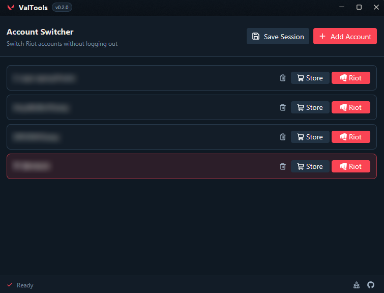

<h1 align="center">ValTools</h1>

`ValTools` is a lightweight [Valorant](https://playvalorant.com) related toolkit for Windows. Switch between multiple Riot accounts without logging out, view your daily shop offers, and clean cache files - all from a single, clean desktop app built with Rust and Slint.

  
   
  

## Features

- **Account Switching**: Save and switch between multiple Riot accounts instantly. No need to re-enter credentials.
- **Daily Shop Viewer**: Check your Valorant daily store offers across all saved accounts with skin images and VP prices.
- **Cache Cleaner**: Browse and selectively clean Valorant cache directories to free up disk space.

## License

Dual Licensed

- [Apache License, Version 2.0](https://www.apache.org/licenses/LICENSE-2.0) ([LICENSE-APACHE](LICENSE-APACHE))
- [MIT license](https://opensource.org/licenses/MIT) ([LICENSE-MIT](LICENSE-MIT))
