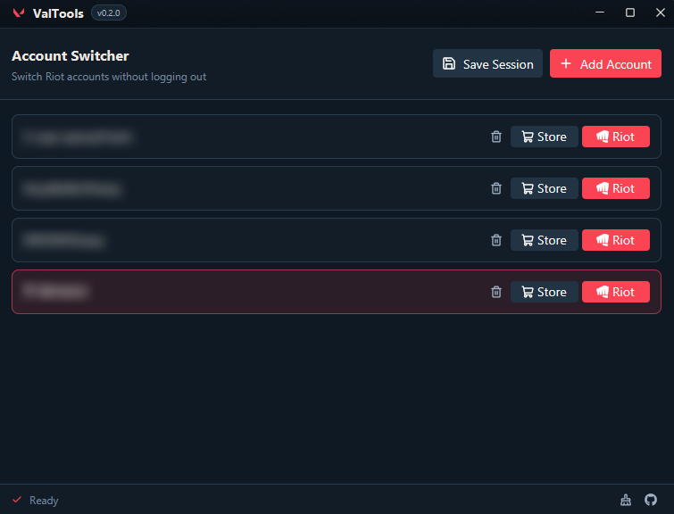
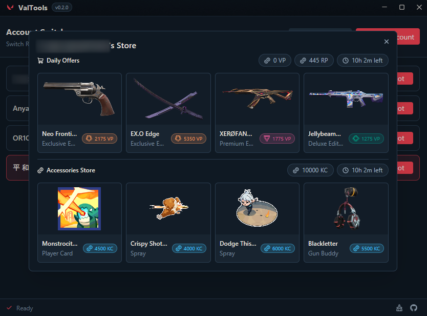

<h1 align="center">ValTools</h1>

[](https://github.com/clitic/valtools/releases)
[](https://github.com/clitic/valtools/releases)
[](https://github.com/clitic/valtools/actions)
[](https://github.com/clitic/valtools)

`ValTools` lets you switch [Valorant](https://playvalorant.com) accounts, check your daily store, and clean cache.

<div align="center">
  
  
  <br>
  <a href="https://github.com/clitic/valtools/releases/download/0.3.0/valtools-0.3.0-x86_64-pc-windows-msvc.zip">
    
  </a>
</div>

## Features

- **Account Switching**: Save and switch between multiple Riot accounts without re-entering credentials.
- **Store & Accessories**: Check daily offers, the accessory store, wallet balances, and reset timers.
- **Valorant Tracker**: Click any account name to view stats on [tracker.gg](https://tracker.gg/valorant).
- **Cache Cleaner**: Clear temporary Valorant cache files to free up disk space.

## Uninstall

ValTools is portable and requires no installation. To uninstall, delete the executable and run this in PowerShell to remove all saved sessions and data:

```powershell
Remove-Item -Path "$env:LOCALAPPDATA\ValTools" -Recurse -Force
```

## License

Dual Licensed

- [Apache License, Version 2.0](https://www.apache.org/licenses/LICENSE-2.0) ([LICENSE-APACHE](LICENSE-APACHE))
- [MIT license](https://opensource.org/licenses/MIT) ([LICENSE-MIT](LICENSE-MIT))
